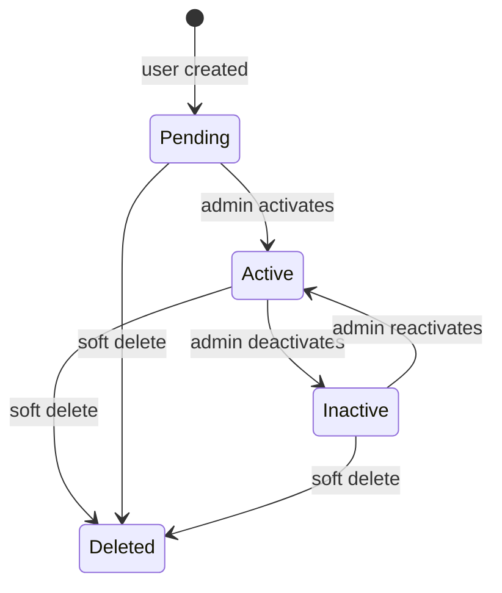

# White Label Studio - Lifecycle & Integration

This document covers retained runtime flows and integration boundaries for the starter.

## Auth Lifecycle



- `PENDING` and `INACTIVE` users cannot log in.
- `ACTIVE` users can log in with valid credentials.
- Successful login updates `last_login_at` and returns an access token.
- Remembered login returns a refresh token and stores only its SHA-256 hash.
- Refresh-token use revokes the old token and issues a new access/refresh pair.

## Request Flow

```txt
React app -> Axios API wrapper -> NestJS controller -> service -> SupabaseService -> PostgreSQL
```

- Public login routes are mounted under `/api/public`.
- Private app routes are mounted under `/api/v1` and require bearer tokens.
- Permission-gated private routes add `RolePermissionGuard`.
- Controllers return the shared response envelope; the global interceptor and exception filter
  normalize responses.

## Profile Flow

- `GET /api/v1/auth/profile` returns the sanitized current user.
- `PATCH /api/v1/auth/profile` updates editable identity fields.
- `PATCH /api/v1/auth/profile/change-password` verifies the old password, rejects matching
  old/new passwords, hashes the new password, and keeps the current session valid.
- `GET /api/v1/auth/profile/roles/permissions` returns the current role and active permission
  grants for future UI controls.

## Integration Boundaries

The starter intentionally does not ship product integrations. Future integrations should follow
these boundaries:

- Secrets live only on the server or secret store, never in frontend bundles.
- External payloads are validated with Zod before persistence or side effects.
- Service tokens are scoped and revocable; user JWTs are not reused for automation.
- Domain events, notifications, queues, and email providers should be added behind services or
  providers, not directly in controllers.

## Database Boundary

Supabase migrations contain only the retained auth/access schema and seed. Add product tables as
new timestamped migrations.
